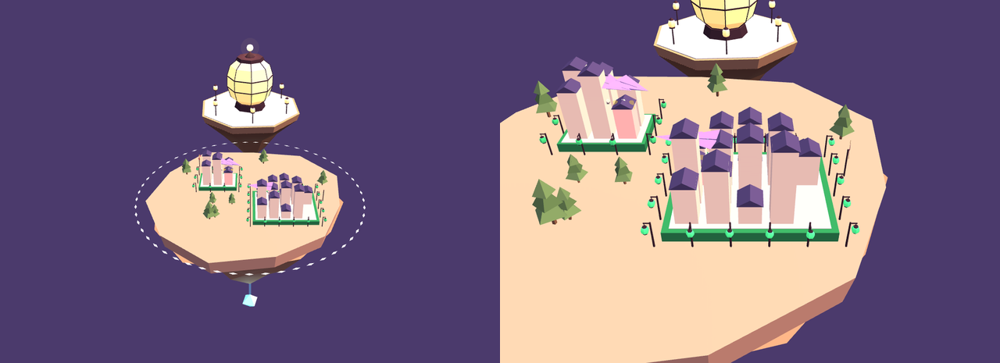

# Skylands themes

Installable, community-made looks for the [Skylands](https://github.com/skylands-ai/skylands)
3D world. Skylands ships with two built-in themes, Default and Sci-fi; a
theme pack here adds another, which every browser on a world can pick
under World theme.

A theme pack is data, not code: a `theme.json`, a `models.glb` of glTF
models, and a `LICENSE`. The world places every model, decides what a click
on it means, and plays only the motions the format offers, so a pack can
change how the world looks and nothing else. It never sees a host, repo, or
file name, and it can't reach the network. [FORMAT.md](FORMAT.md) describes
the format.

## Packs

| Pack | Description |
| --- | --- | 
| [Paper Lanterns](paper-lanterns) | A world of folded paper, lit from inside, at dusk |



## Adding a pack to your world

Theme packs need a Skylands release with the `skylands theme` command.
List the packs here, and add one by its id, against the world's NATS
server:

```sh
skylands theme search
skylands theme add paper-lanterns
```

`search` and `add` read [index.json](index.json), which lists every pack
here with the sha256 of its files; `add` downloads the pack's files and
refuses them unless they have it. `skylands devworld up` runs NATS at the
default `--nats-url`; for a world on your own NATS server, pass
`--nats-url` and `--creds` as you do for `skylands citadel up`. `add` also
takes a pack's directory, such as `./paper-lanterns` in a clone of this
repository, a `.zip` of one, or an `https://` URL of a `.zip`, and
`--sha256` refuses a pack unless it is exactly the one you expect.

The pack is stored in the world, so every citadel offers it at once. Each
browser picks its own theme. `skylands theme list` shows what the world
has, and `skylands theme remove <id>` takes a pack out; browsers drawing in
it go back to Default. A pack with the same id is never replaced unless
`skylands theme add --replace` says so.

## Making a pack

1. Make a directory named for your pack's id, with its `theme.json`,
   `models.glb`, and `LICENSE`. Anything else there, such as a README, a
   preview image, or the source of your models, stays in this repository
   and isn't part of the pack.
2. Model in anything that exports glTF 2.0 binary, such as Blender. Name
   the root of each model as your `theme.json` names it, and the parts the
   world looks for as [FORMAT.md](FORMAT.md) describes. Leave out normals
   for a flat-shaded look, and keep every texture inside the file.
3. Check it as a citadel will:

   ```sh
   skylands theme check ./your-pack
   ```

4. Try it on a world of your own with `skylands devworld up` and
   `skylands theme add ./your-pack`, at every level: the whole world, an
   island, a terrace, and a building, in each state.
5. List it in [index.json](index.json), which `skylands theme search`
   reads, with `npm ci && npm run index`.
6. Open a pull request with a `preview.png`, the new `index.json`, and a
   line in the table above.

CI checks every pack the same way, and that `index.json` lists each one
as it is, so review here is for quality and taste; the format and the
citadel handle safety.

Paper Lanterns' models are built from code, by
[paper-lanterns/source/build.mjs](paper-lanterns/source/build.mjs):

```sh
npm ci
npm run build
```

## License

The scripts here are under the Apache License 2.0, in [LICENSE](LICENSE).
Each pack's models are under the license in its own `LICENSE` file, which
its `theme.json` names.
