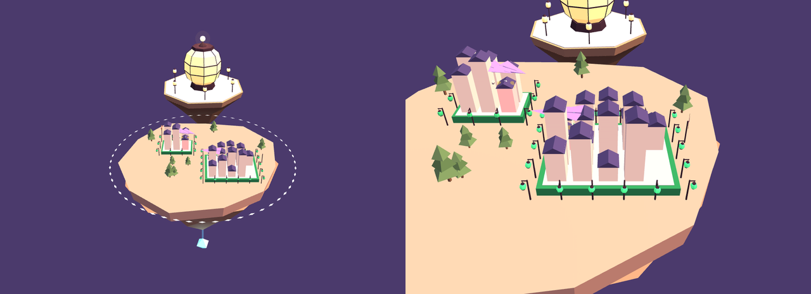

# Paper Lanterns

A world of folded paper, lit from inside, at dusk.

```sh
skylands theme add paper-lanterns
```



| Part | How it looks |
| --- | --- |
| Citadel | A great paper lantern with lacquered ribs, on a folded platform ringed by small lanterns. A crystal hangs below on a string |
| Islands | Faceted paper rocks in sage, peach, or lilac, with paper trees, folds, and pinwheels that turn |
| Selection ring | A ring of glowing paper diamonds that turns slowly |
| Terraces | A paper mat edged in the repo's color, ringed by posts whose lanterns glow in it, sway, and brighten while the terrace is selected |
| Buildings | Paper boxes under slate-violet roofs: plain at rest, lit blue while read, amber while edited, red in conflict |
| Airships | A crane for Claude, a boat for Codex, a lantern balloon for Gemini, a goose for goose, and a dart for local models, each in its provider's color |
| Visitor | A kite trailing a ribbon tail |
| Sky | Indigo dusk with faint stars |

The models are built from code by [source/build.mjs](source/build.mjs), so
they can be read and reviewed as text. `npm run build` from the
repository's root writes `models.glb` again.

Licensed under the Apache License 2.0, in [LICENSE](LICENSE).
