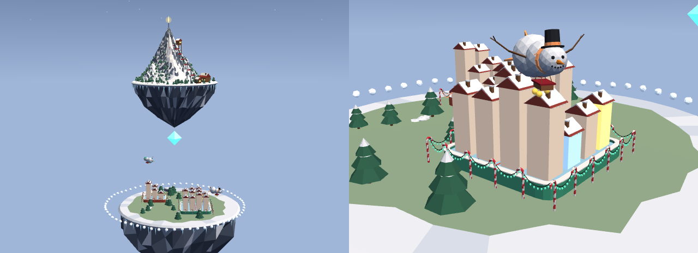

# Winter

A snowy world at blue hour: a ski mountain, ice rinks ringed by candy canes
and lights, and snowman dirigibles.

```sh
skylands theme add winter
```



| Part | How it looks |
| --- | --- |
| Citadel | A big snowy mountain on a floating rock fringed with icicles, with a star on its summit. A chairlift climbs it on towers, its chairs going round, beside two ski runs cut through the pines, where two skiers carve down. A lodge and the lift's huts stand at its foot |
| Islands | Floating rocks with snow round their edges and icicles under the lip, their middles frosted green, moss, or straw, with snowy pines, drifts, boulders, and the odd snowman |
| Selection ring | A ring of snowballs that bob as it turns |
| Terraces | An ice rink, its boards in the repo's color, ringed by candy canes strung with lights that glow in the repo's color and brighten while the terrace is selected |
| Buildings | Chalets under snowy roofs hung with icicles: cream at rest, lit blue while read, amber while edited, red in conflict |
| Airships | Snowman dirigibles: three snowballs nose to tail, with a coal face, a carrot nose, stick-arm fins, a propeller, and a scarf in the provider's color. Claude wears a top hat, Codex a bobble beanie, Gemini a pail, goose a floppy stocking cap, and local models earmuffs. Gold baubles hang beneath for the context used |
| Visitor | A sleigh pulled by two pairs of galloping reindeer, trailing sparkles |
| Sky | Blue-hour twilight with faint stars and clouds |

The lights are the terrace's `rope`, which the world hangs from the top of
each cane's hook to the next all the way round, with a `bulb` bead strung
along it every 0.12.

The models are built from code by [source/build.mjs](source/build.mjs), so
they can be read and reviewed as text. `npm run build` from the
repository's root writes `models.glb` again.

Licensed under the Apache License 2.0, in [LICENSE](LICENSE).
